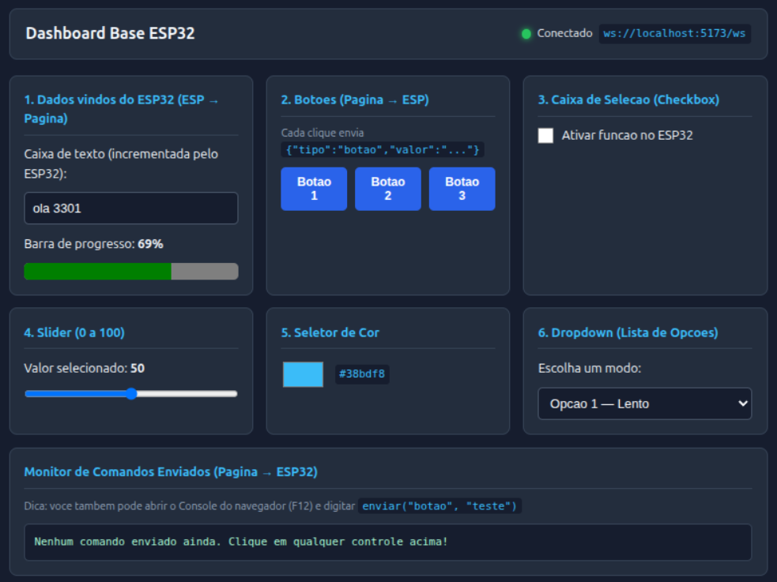

# Dashboard Base Simplificado — ESP32 + WebSocket (`/ws`) + Tailscale (MicroLink)


Projeto base **mínimo e didático** para criar painéis web (HTML + CSS + JS) e conversar em tempo real com o ESP32-S3 via **WebSocket**, usando **ESP-IDF v5.5.x** em C puro, integrado à rede VPN mesh **Tailscale (WireGuard / DERP)** através da biblioteca embarcada **MicroLink v2**, além de um ambiente **Docker** para desenhar e testar o painel no PC antes de gravar na placa.



> **Créditos:**
> - A integração com a API de coordenação da Tailscale e protocolos WireGuard/DERP utiliza o projeto open-source [MicroLink](https://github.com/CamM2325/microlink), criado por **Cameron Malone**.
> - Usa o [ESP-IDF](https://github.com/espressif/esp-idf), o [cJSON](https://github.com/DaveGamble/cJSON) e, no mock, [ws](https://github.com/websockets/ws) e [chokidar](https://github.com/paulmillr/chokidar).

## Índice

1. [Estrutura de Diretórios](#1-estrutura-de-diretórios)
2. [Portas e Serviços no ESP32](#2-portas-e-serviços-no-esp32)
3. [Como Funciona a Comunicação WebSocket (`/ws`)](#3-como-funciona-a-comunicação-websocket-ws)
   - [3.1 Do Navegador para o ESP32](#31-do-navegador-para-o-esp32-enviartipo-valor-no-appjs)
   - [3.2 Do ESP32 para o Navegador](#32-do-esp32-para-o-navegador-tarefa_ola-no-dashboard_portalc)
4. [Passo a Passo: Criando e Testando no PC com Docker](#4-passo-a-passo-criando-e-testando-no-pc-com-docker-sem-o-esp32)
5. [Passo a Passo: Configurando Tailscale e Gravando no ESP32-S3](#5-passo-a-passo-configurando-tailscale-e-gravando-no-esp32-s3)
6. [Guia Prático: Como Criar Seus Próprios Controles](#6-guia-prático-como-criar-seus-próprios-controles)
7. [Segurança](#7-segurança)
8. [Licença](#8-licença)

---

## 1. Estrutura de Diretórios

```text
dashboard_base/
├── .github/assets/            # Imagens usadas no README
├── .gitignore                 # Ignora build/, sdkconfig (contém senhas/chaves), .vscode/...
├── CMakeLists.txt             # CMake raiz do projeto ESP-IDF
├── LICENSE                    # Licença MIT
├── sdkconfig.defaults         # Configurações padrão (ESP32-S3 N16R8, PSRAM, WebSocket, MicroLink)
├── README.md                  # Este guia passo a passo
├── components/
│   ├── microlink/             # Cliente Tailscale / WireGuard / DERP / STUN / DISCO + Portal HTTP (:80)
│   └── wireguard_lwip/        # Implementação WireGuard integrada ao lwIP
├── main/
│   ├── CMakeLists.txt         # Compila main/src/*.c, expõe main/include e embute web_gui/ na Flash
│   ├── Kconfig.projbuild      # Menus do `idf.py menuconfig` (Example Configuration & Dashboard Configuration)
│   ├── include/
│   │   ├── wifi_manager.h     # Cabeçalho do gerenciador Wi-Fi (Multi-SSID NVS / Kconfig)
│   │   ├── tailscale_app.h    # Cabeçalho da aplicação MicroLink / Tailscale + UDP Echo
│   │   └── dashboard_portal.h # Cabeçalho do servidor HTTP + WebSocket do Dashboard (:8080)
│   ├── src/
│   │   ├── main.c             # Ponto de entrada (app_main): orquestra NVS, Wi-Fi, Dashboard e Tailscale
│   │   ├── wifi_manager.c     # Conexão Wi-Fi Station com suporte a Multi-SSID via NVS e PS=NONE
│   │   ├── tailscale_app.c    # Inicialização do MicroLink, callbacks VPN, UDP 9000 e telemetria
│   │   └── dashboard_portal.c # Servidor HTTP + WebSocket (/ws) + JSON (cJSON) na porta 8080
│   └── web_gui/               # Os 3 arquivos do seu dashboard (usados no Docker e no ESP32)
│       ├── index.html         # Estrutura dos controles (botões, slider, cor, etc.)
│       ├── style.css          # Visual e cores
│       └── app.js             # Envio e recebimento de JSON via WebSocket
└── docker/                    # Simulador do ESP32 no PC (com Live-Reload)
    ├── Dockerfile
    ├── docker-compose.yml
    ├── package.json
    ├── mock_server.js         # Simula o backend do ESP32 em Node.js
    └── README.md
```

---

## 2. Portas e Serviços no ESP32

Ambos os servidores HTTP escutam em todas as interfaces de rede do ESP32 (tanto na rede Wi-Fi local quanto na interface virtual WireGuard/Tailscale):

| Porta | Serviço | Endereço na Rede Local (LAN) | Endereço via Tailscale (VPN) |
| :--- | :--- | :--- | :--- |
| **TCP 80** | **Portal de Gestão do MicroLink** (status da VPN, peers, troca de Wi-Fi e Auth Key em NVS) | `http://192.168.x.x/` | `http://100.x.y.z/` |
| **TCP 8080** | **Dashboard Web + WebSocket (`/ws`)** | `http://192.168.x.x:8080/` | `http://100.x.y.z:8080/` |
| **UDP 9000** | **Socket UDP de Eco sobre a VPN** | — | `echo "olá" \| nc -u 100.x.y.z 9000` |

---

## 3. Como Funciona a Comunicação WebSocket (`/ws`)

Tanto o `mock_server.js` (no Docker) quanto o `dashboard_portal.c` (no ESP32) usam **exatamente o mesmo protocolo JSON** no endereço `/ws`.

### 3.1 Do Navegador para o ESP32 (`enviar(tipo, valor)` no `app.js`)

Sempre que você interage com um controle na página, o `app.js` chama `enviar(tipo, valor)`, que manda um JSON com duas chaves: `"tipo"` e `"valor"`:

| Controle na Página | Quando dispara | JSON enviado pelo WebSocket | Onde é tratado no ESP32 (`main/src/dashboard_portal.c`) |
|---|---|---|---|
| **Botões 1, 2, 3** | Ao clicar (`click`) | `{"tipo":"botao","valor":"1"}` | `strcmp(tipo, "botao") == 0` |
| **Caixa de seleção** | Ao marcar/desmarcar (`change`) | `{"tipo":"checkbox","valor":true}` | `strcmp(tipo, "checkbox") == 0` |
| **Slider (0–100)** | Ao soltar o controle (`change`) | `{"tipo":"slider","valor":50}` | `strcmp(tipo, "slider") == 0` |
| **Seletor de cor** | Ao escolher a cor (`change`) | `{"tipo":"cor","valor":"#38bdf8"}` | `strcmp(tipo, "cor") == 0` |
| **Dropdown** | Ao trocar a opção (`change`) | `{"tipo":"dropdown","valor":"opcao2"}` | `strcmp(tipo, "dropdown") == 0` |

### 3.2 Do ESP32 para o Navegador (`tarefa_ola` no `dashboard_portal.c`)

A cada **1 segundo**, o ESP32 (ou o Mock no Docker) incrementa um contador e envia para todos os navegadores conectados:

```json
{"tipo":"ola","texto":"ola 7","contador":7,"progresso":7}
```

No `app.js`, o bloco `switch (msg.tipo)` captura `case "ola":` e atualiza:
- A **caixa de texto** (`#caixa-ola`) com `"ola 7"`.
- A **barra de progresso** (`#barra-progresso`) com `7` (de 0 a 100%).

---

## 4. Passo a Passo: Criando e Testando no PC com Docker (Sem o ESP32)

1. Suba o container Docker:
   ```bash
   cd docker
   docker compose up -d --build
   ```
2. Abra no navegador: **`http://localhost:5173`**
3. Para ver os logs das mensagens chegando no "ESP32 simulado", rode no terminal:
   ```bash
   docker compose logs -f
   ```
4. **Dica para testar sem criar HTML ainda:** abra o Console do navegador (`F12` &rarr; aba **Console**) e digite:
   ```javascript
   enviar("botao", "1")
   enviar("meu_teste", "qualquer valor")
   ```

---

## 5. Passo a Passo: Configurando Tailscale e Gravando no ESP32-S3

### 5.1 Gerar a Chave de Autenticação (Auth Key) no Tailscale
1. Acesse o [Admin Console do Tailscale](https://login.tailscale.com/admin/settings/keys).
2. Clique em **Generate auth key...** e copie a chave gerada (`tskey-auth-...`).

### 5.2 Configurar o Projeto (`menuconfig`)
```bash
idf.py menuconfig
```
- Em **`Example Configuration`**:
  - Informe **`WiFi SSID`**, **`WiFi Password`** e **`Tailscale Auth Key`**.
- Em **`Dashboard Configuration`**:
  - Ajuste a porta HTTP do Dashboard se desejar (padrão **`8080`**).

### 5.3 Compilar e Gravar
```bash
idf.py build flash monitor
```

### 5.4 Acessar os Portais
- **Na rede local (Wi-Fi):**
  - Portal MicroLink: `http://192.168.x.x/`
  - Dashboard Web: `http://192.168.x.x:8080/`
- **Remotamente (de qualquer lugar, com o app Tailscale ativo no celular ou PC):**
  - Portal MicroLink: `http://100.x.y.z/`
  - Dashboard Web: `http://100.x.y.z:8080/`

---

## 6. Guia Prático: Como Criar Seus Próprios Controles

### Exemplo A: Adicionar um controle novo (Página &rarr; ESP32) em 3 passos

1. **No `main/web_gui/index.html`:** adicione o HTML dentro de `<main class="grade">`:
   ```html
   <section class="cartao">
       <h2>Meu Novo Controle</h2>
       <input type="text" id="meu-campo" placeholder="Digite algo...">
       <button type="button" id="meu-botao">Enviar para o ESP32</button>
   </section>
   ```
2. **No `main/web_gui/app.js`:** capture o clique e chame `enviar(tipo, valor)`:
   ```javascript
   const meuCampo = document.getElementById("meu-campo");
   const meuBotao = document.getElementById("meu-botao");

   meuBotao.addEventListener("click", () => {
       enviar("nome_usuario", meuCampo.value);
   });
   ```
3. **No `main/src/dashboard_portal.c` (dentro de `tratar_mensagem`):** adicione mais um `else if`:
   ```c
   else if (strcmp(tipo, "nome_usuario") == 0 && cJSON_IsString(item_valor)) {
       ESP_LOGI(TAG, "Nome digitado na pagina: %s", item_valor->valuestring);
   }
   ```

### Exemplo B: Enviar um dado novo do ESP32 para a Página (ESP32 &rarr; Página)

1. **No `main/src/dashboard_portal.c`**, monte o JSON com `cJSON` e chame `enviar_para_todos_ws()`:
   ```c
   cJSON *root = cJSON_CreateObject();
   cJSON_AddStringToObject(root, "tipo", "temperatura");
   cJSON_AddNumberToObject(root, "valor", 26.5);
   char *json_str = cJSON_PrintUnformatted(root);
   enviar_para_todos_ws(json_str);
   free(json_str);
   cJSON_Delete(root);
   ```
2. **No `main/web_gui/app.js`**, dentro do `switch (msg.tipo)` em `ws.onmessage`, adicione um `case`:
   ```javascript
   case "temperatura":
       console.log("Temperatura vinda do ESP32:", msg.valor);
       break;
   ```

---

## 7. Segurança

- Suas credenciais Wi-Fi e a Tailscale Auth Key ficam apenas no `sdkconfig` (ignorado pelo `.gitignore`) ou na partição NVS da placa. Nunca faça commit do `sdkconfig`.
- Todo o tráfego que passa pela Tailscale é criptografado ponta a ponta com **WireGuard (ChaCha20-Poly1305)** e dispensa redirecionamento de portas (*port forwarding*) no roteador.
- Os portais HTTP (portas 80 e 8080) e o WebSocket `/ws` não possuem tela de login/senha: qualquer dispositivo conectado na mesma rede Wi-Fi local ou autorizado na sua Tailnet pode acessá-los.

---

## 8. Licença

Distribuído sob a licença MIT. Veja [LICENSE](LICENSE).
